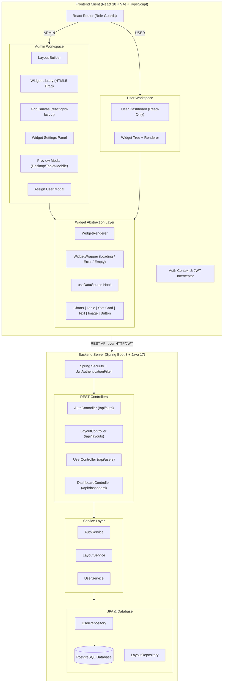
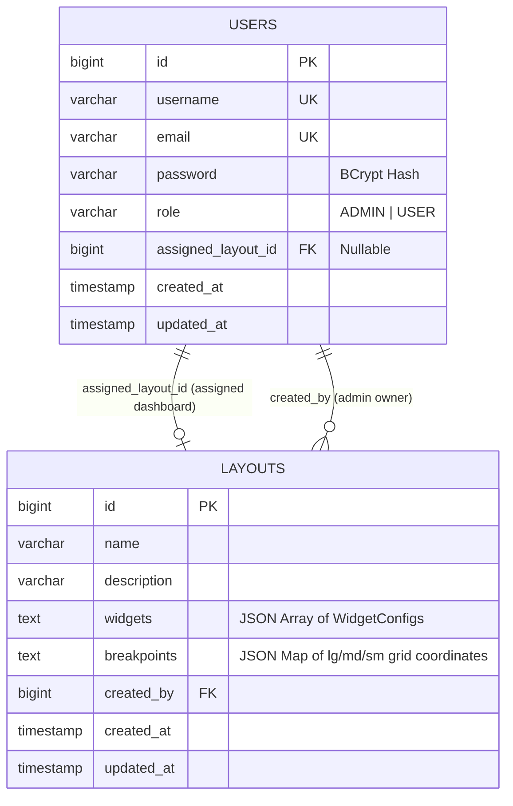
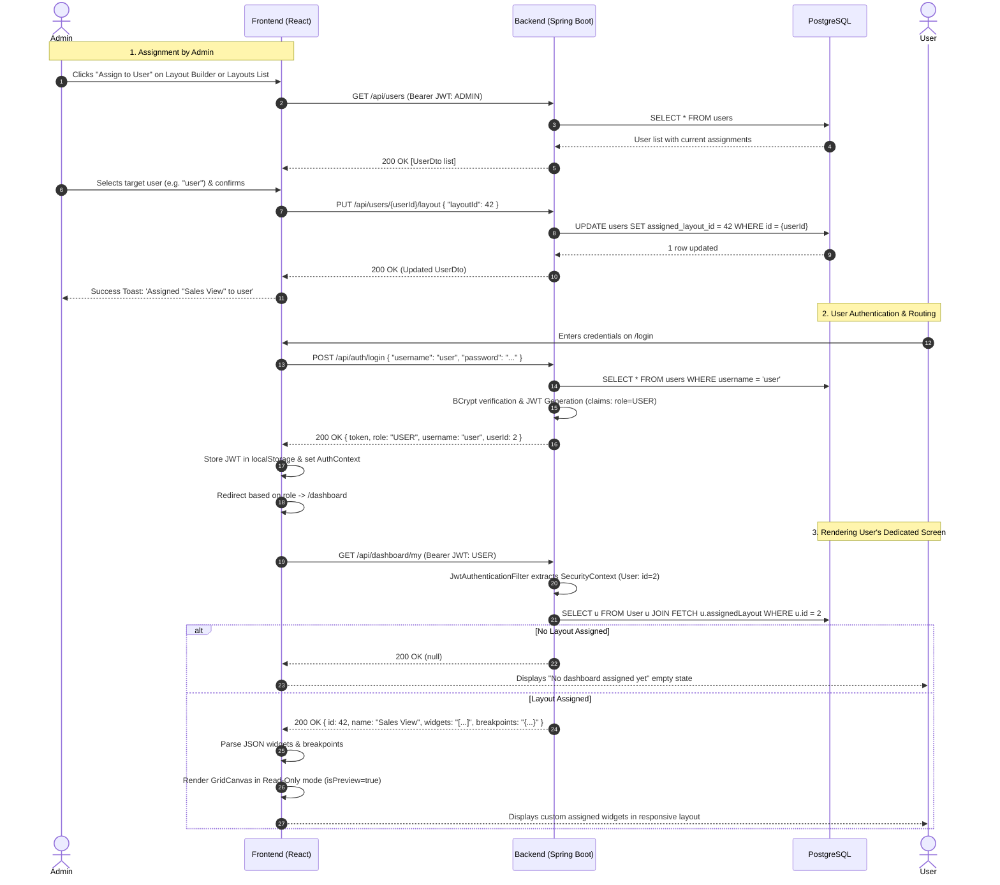
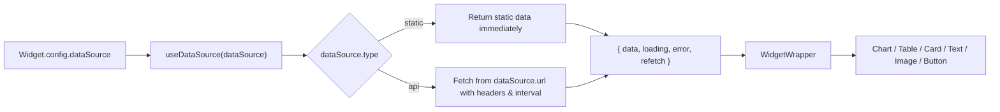

# Dashboard Builder — Comprehensive Architecture & Design Guide

## 1. Executive Summary & Vision

**Dashboard Builder** is an enterprise-grade, full-stack application that enables administrators to design bespoke, responsive dashboards using an interactive drag-and-drop canvas, and seamlessly assign these dashboards to specific users.

### Core Philosophy
1. **Strict Multi-Tenant Isolation by User**: Each user is assigned exactly one dashboard. When a user logs in, they are immediately routed to their dedicated dashboard rendered in read-only mode. A regular user cannot view, list, or discover any other user's dashboard or admin layout tools.
2. **Unified Data Source Abstraction**: Widgets do not hardcode their data sources. Every widget is built against an extensible data layer (`useDataSource`) that currently serves static mock/JSON data and is architecturally ready for external REST APIs with custom headers, polling intervals, and field mappings—requiring zero widget refactoring.
3. **Responsive Grid & Breakpoint Sync**: Dashboards adapt smoothly across Desktop (12 columns), Tablet (8 columns), and Mobile (4 columns). Layout modifications made in the builder automatically preserve vertical hierarchy across breakpoints.

---

## 2. High-Level System Architecture



---

## 3. How User-Specific Dashboard Assignment Works

The primary requirement of Dashboard Builder is: **"An Admin builds a custom screen, previews it, and assigns it to a User. When that User logs in, they see only their own assigned screen."**

### 3.1 Data Model Relationship

The relationship between `User` and `Layout` is modeled in the database as:
- **`Layout`**: Contains the layout metadata, the JSON string of configured widgets, the JSON string of responsive breakpoint coordinates, and the creator reference (`User createdBy`).
- **`User`**: Has an `@ManyToOne` foreign key `assigned_layout_id` referencing `Layout`.
- **Constraint**: A user has at most one assigned layout at any given time. Assigning a new layout replaces the previous reference.



### 3.2 End-to-End Assignment & Login Sequence



### 3.3 Security & Isolation Guarantees

1. **Role-Based API Protection** ([`SecurityConfig.java`](file:///Users/kamal/Downloads/temple-app/backend/src/main/java/com/dashboardbuilder/config/SecurityConfig.java)):
   - `/api/layouts/**` -> Accessible **strictly by `ROLE_ADMIN`**. Regular users receive `403 Forbidden`.
   - `/api/users/**` -> Accessible **strictly by `ROLE_ADMIN`**.
   - `/api/dashboard/my` -> Accessible by authenticated users (`ROLE_USER` or `ROLE_ADMIN`).
2. **Context-Derived Identity**:
   - `GET /api/dashboard/my` accepts **no user ID query parameter**. The backend extracts the user identity directly from the cryptographically verified JWT in the `Authorization: Bearer <token>` header. A user cannot query another user's layout by manipulating URL parameters.
3. **Cascade Safety**:
   - If an Admin deletes a layout ([`LayoutService.java`](file:///Users/kamal/Downloads/temple-app/backend/src/main/java/com/dashboardbuilder/service/LayoutService.java#L92)), the service first unassigns any users linked to that layout by setting `user.assigned_layout = null` before deleting the layout record, preventing dangling foreign key errors or crashes.

---

## 4. Frontend Component & Layout Architecture

### 4.1 Route Map & Access Control

```
/ (Root) ──> Redirect to /login
├── /login ──> LoginPage (public)
├── /admin ──> ProtectedRoute(role="ADMIN") ──> AdminDashboard (Layout cards & actions)
├── /admin/builder/:id ──> ProtectedRoute(role="ADMIN") ──> LayoutBuilder (The visual designer)
├── /dashboard ──> ProtectedRoute(role="USER" or "ADMIN") ──> UserDashboard (User's view)
└── * ──> NotFound (404 catch-all)
```

### 4.2 Layout Builder Workspace Breakdown

The builder ([`LayoutBuilder.tsx`](file:///Users/kamal/Downloads/temple-app/frontend/src/pages/LayoutBuilder.tsx)) is divided into four integrated regions:

```
┌────────────────────────────────────────────────────────────────────────────────────────┐
│ TOP BAR: Layout Name | Unsaved Badge | [Desktop|Tablet|Mobile] | Preview | Assign | Save│
├──────────────┬──────────────────────────────────────────────────────────┬──────────────┤
│ WIDGET       │ GRID CANVAS                                              │ WIDGET       │
│ LIBRARY      │ - react-grid-layout with vertical compaction             │ SETTINGS     │
│ (256px)      │ - Snaps to 12 columns (Desktop) / 8 (Tablet) / 4 (Mobile)│ PANEL        │
│              │ - Drag & drop placement with HTML5 dataTransfer          │ (320px)      │
│ - Charts     │ - Live resize handles on items                           │ - Appearance │
│ - Data Table │ - Delete button on hover                                 │ - Data Source│
│ - Stat Card  │ - Item selection ring                                    │ - Live JSON  │
│ - Text Block │                                                          │   validator  │
│ - Image      │                                                          │              │
│ - Button     │                                                          │              │
└──────────────┴──────────────────────────────────────────────────────────┴──────────────┘
```

#### A. Widget Library ([`WidgetLibrary.tsx`](file:///Users/kamal/Downloads/temple-app/frontend/src/components/builder/WidgetLibrary.tsx))
- Provides 8 pre-configured widget template cards (Bar, Line, Pie charts, Data Table, Stat Card, Text, Image, Button).
- Supports dual insertion models:
  1. **HTML5 Drag-and-Drop**: Sets `event.dataTransfer.setData('application/json', ...)` with default dimensions (`w`, `h`) and dropped directly on the grid coordinates.
  2. **One-Click Add (`+`)**: Computes the lowest Y coordinate on the current canvas and stacks the new widget cleanly at the bottom.

#### B. Grid Canvas ([`GridCanvas.tsx`](file:///Users/kamal/Downloads/temple-app/frontend/src/components/builder/GridCanvas.tsx))
- Built on `react-grid-layout` using `WidthProvider(Responsive)`.
- Breakpoint thresholds:
  - `lg`: `>= 1024px` (12 columns)
  - `md`: `640px - 1023px` (8 columns)
  - `sm`: `< 640px` (4 columns)
- **Automatic Compaction**: `compactType="vertical"` ensures no gaps or overlapping items.

#### C. Cross-Breakpoint Synchronization Engine
When a layout change occurs in the active breakpoint, the builder does not let other viewports fall out of sync:
```typescript
// Synchronizes updated vertical order and dimensions across all screen tiers
if (currentBp === 'lg') {
  nextLg = activeList;
  nextMd = activeList.map((item) => ({
    i: item.i,
    x: Math.min(item.x, 8 - Math.min(item.w, 8)),
    y: item.y, // preserve vertical flow
    w: Math.min(item.w, 8),
    h: item.h,
    minW: item.minW,
    minH: item.minH,
  }));
  nextSm = activeList.map((item) => ({
    i: item.i,
    x: 0,
    y: item.y, // preserve vertical flow
    w: 4,
    h: item.h,
    minW: item.minW,
    minH: item.minH,
  }));
}
```

#### D. Widget Settings Panel ([`WidgetSettings.tsx`](file:///Users/kamal/Downloads/temple-app/frontend/src/components/builder/WidgetSettings.tsx))
- Dynamically switches forms according to the selected widget's `type`:
  - **Charts**: Toggle between Bar/Line/Pie, customize color palettes, edit labels.
  - **Tables**: Add/remove columns with custom data keys, change page size.
  - **Stat Cards**: Customize metric value, label, accent color, and Lucide icon.
  - **Text**: Content editor, font size slider (12px–36px), left/center/right alignment.
  - **Image**: Image URL, alt text, object-fit mode (cover, contain, fill).
  - **Button**: Button label, target destination link, solid vs outline style, theme color.

---

## 5. Widget Architecture & Extensible Data Layer

### 5.1 The `WidgetConfig` Data Contract

Every widget configuration adheres to a standardized schema that isolates its visual properties from its data retrieval logic:

```typescript
export interface DataSource {
  type: 'static' | 'api';
  data?: any;                          // In-memory data for static mode
  url?: string;                        // Target REST endpoint for API mode
  method?: 'GET' | 'POST' | 'PUT' | 'DELETE';
  headers?: Record<string, string>;   // Custom auth or request headers
  refreshInterval?: number;            // Polling interval in milliseconds
  mapping?: Record<string, string>;   // Field transformation mapping
}

export interface Widget {
  i: string;                           // Unique identifier (e.g. "widget-1713429381")
  type: 'chart' | 'table' | 'card' | 'text' | 'image' | 'button';
  config: WidgetConfig;
}
```

### 5.2 Unified Data-Fetching Hook (`useDataSource`)

Instead of widgets fetching data directly or handling HTTP logic, all widgets consume the single hook [`useDataSource.ts`](file:///Users/kamal/Downloads/temple-app/frontend/src/hooks/useDataSource.ts):



#### Benefits of this Pattern:
1. **Zero Widget Code Changes**: When connecting to live production APIs, none of the 6 widget components require edits. Only `useDataSource.ts` executes the HTTP request.
2. **Standardized States**: Every widget automatically inherits:
   - **Loading state**: Animated spinner ([`WidgetWrapper.tsx`](file:///Users/kamal/Downloads/temple-app/frontend/src/components/widgets/WidgetWrapper.tsx#L24))
   - **Error state**: Error banner with a "Retry" trigger ([`WidgetWrapper.tsx`](file:///Users/kamal/Downloads/temple-app/frontend/src/components/widgets/WidgetWrapper.tsx#L32))
   - **Empty state**: Clean "No data available" placeholder ([`WidgetWrapper.tsx`](file:///Users/kamal/Downloads/temple-app/frontend/src/components/widgets/WidgetWrapper.tsx#L45))

---

## 6. Backend REST API Reference

All protected endpoints require an `Authorization: Bearer <jwt_token>` header.

### 6.1 Authentication (`/api/auth`)
| Method | Endpoint | Access | Request Body | Response Body |
|---|---|---|---|---|
| `POST` | `/api/auth/login` | Public | `{ username, password }` | `{ token, username, role, userId }` |

### 6.2 Layout Management (`/api/layouts` — Admin Only)
| Method | Endpoint | Access | Description |
|---|---|---|---|
| `GET` | `/api/layouts` | ADMIN | Lists all saved dashboard layouts with assigned user summaries |
| `GET` | `/api/layouts/{id}` | ADMIN | Retrieves full details, widgets JSON, and breakpoint coordinates |
| `POST` | `/api/layouts` | ADMIN | Creates a new dashboard layout |
| `PUT` | `/api/layouts/{id}` | ADMIN | Updates an existing dashboard layout |
| `DELETE` | `/api/layouts/{id}` | ADMIN | Deletes layout (automatically unassigns linked users) |
| `POST` | `/api/layouts/{id}/duplicate` | ADMIN | Duplicates layout, appending `"Copy of "` to its name |

### 6.3 User Management (`/api/users` — Admin Only)
| Method | Endpoint | Access | Description |
|---|---|---|---|
| `GET` | `/api/users` | ADMIN | Lists all system users, roles, and current assigned layout name |
| `PUT` | `/api/users/{userId}/layout` | ADMIN | Assigns or replaces a user's assigned layout (`{ "layoutId": 42 }`) |

### 6.4 User Dashboard (`/api/dashboard` — Authenticated Users)
| Method | Endpoint | Access | Description |
|---|---|---|---|
| `GET` | `/api/dashboard/my` | USER / ADMIN | Returns the caller's assigned dashboard layout, or `null` if none |

---

## 7. Storage & Serialization Architecture

### Database Storage of Dynamic Grid Layouts
Relational databases are rigid for heterogeneous widgets with varying configuration shapes. Rather than maintaining a complex EAV (Entity-Attribute-Value) schema, the backend stores:
- **`Layout.widgets`**: A PostgreSQL `TEXT` column storing the JSON array of widget configurations.
- **`Layout.breakpoints`**: A PostgreSQL `TEXT` column storing the JSON map of coordinates:
  ```json
  {
    "lg": [{"i": "widget-1", "x": 0, "y": 0, "w": 6, "h": 5}],
    "md": [{"i": "widget-1", "x": 0, "y": 0, "w": 8, "h": 5}],
    "sm": [{"i": "widget-1", "x": 0, "y": 0, "w": 4, "h": 5}]
  }
  ```

### The API Serialization Adapter ([`layouts.ts`](file:///Users/kamal/Downloads/temple-app/frontend/src/api/layouts.ts))
To prevent runtime type mismatches between Java `String` columns and TypeScript typed interfaces, the frontend API adapter handles bi-directional transformation:
- **On Save (`createLayout` / `updateLayout`)**: Converts `Widget[]` and `Breakpoints` into JSON text strings.
- **On Receive (`getLayout` / `getLayouts` / `getMyDashboard`)**: Safely `JSON.parse`es the string attributes into typed objects, falling back to empty structures if null or malformed.

---

## 8. Development & Deployment Procedures

### Default Seed Credentials

| Role | Username | Password | Email |
|---|---|---|---|
| **ADMIN** | `admin` | `admin123` | `admin@dashboard.com` |
| **USER** | `user` | `user123` | `user@dashboard.com` |

### Running the Project Locally

```bash
# 1. PostgreSQL Database Initialization
createdb dashboard_builder

# 2. Start the Backend API (Spring Boot on port 8080)
cd backend
mvn spring-boot:run

# 3. Start the Frontend (Vite on port 5173 with proxy to :8080)
cd frontend
npm install
npm run dev
```

### Running Backend Unit & Integration Tests
```bash
cd backend
mvn clean test
```
The test suite validates:
- Password encryption & JWT token expiration
- Spring Security role enforcement (preventing users from accessing `/api/layouts` and `/api/users`)
- User layout assignment & replacement
- Layout duplication and unassignment on deletion
